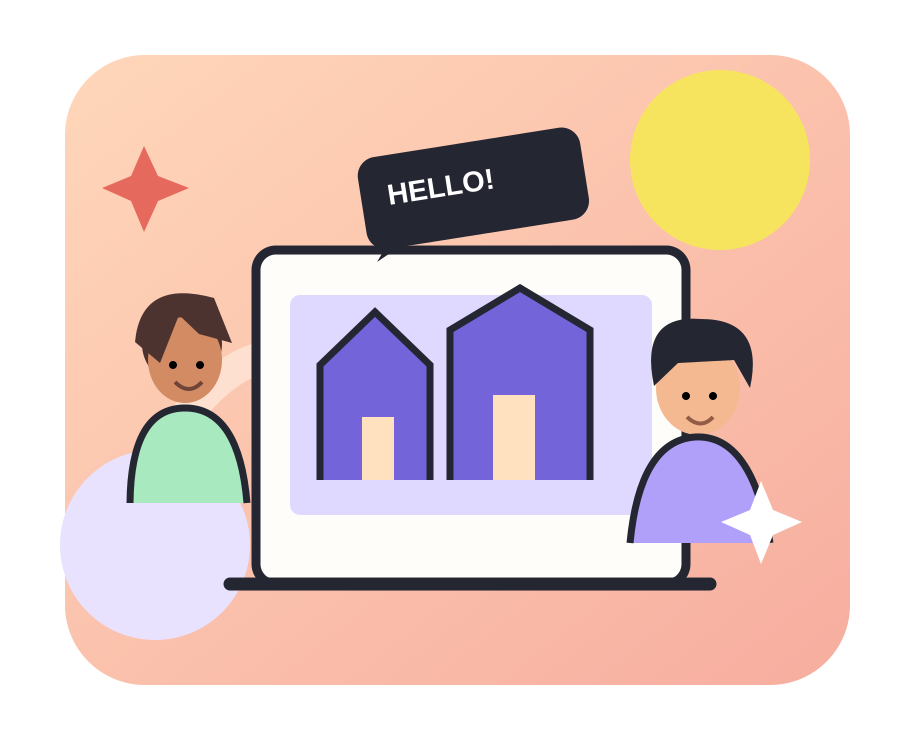
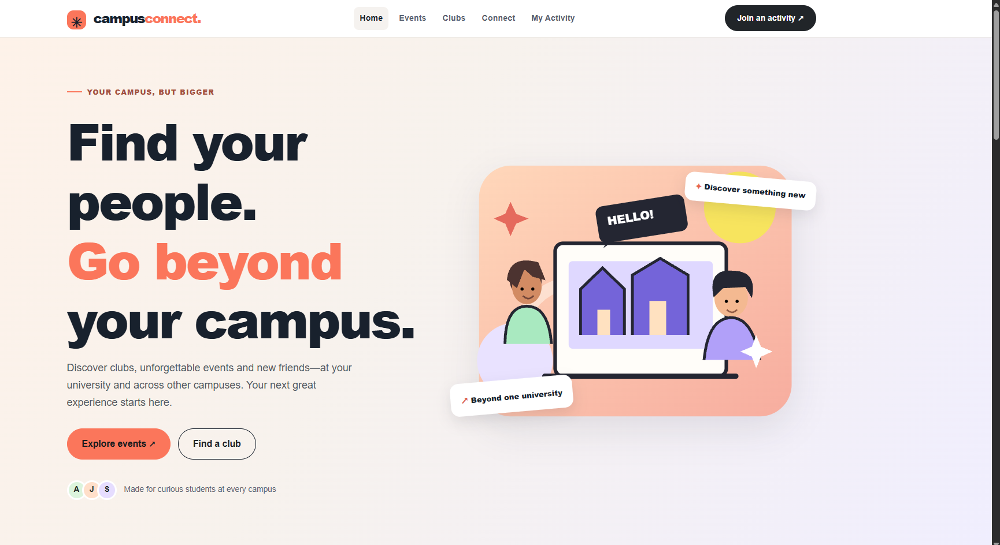
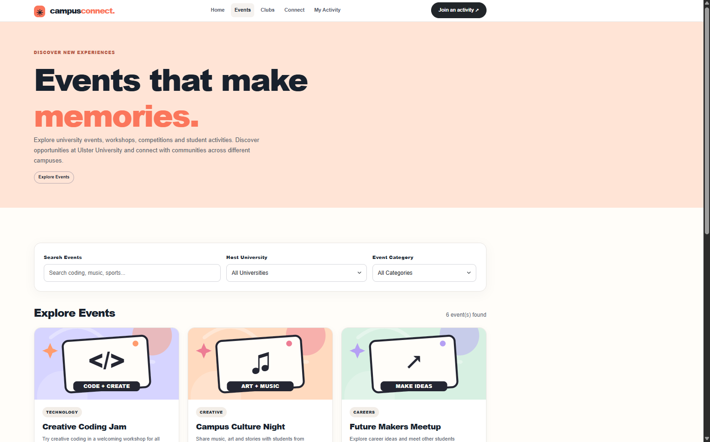
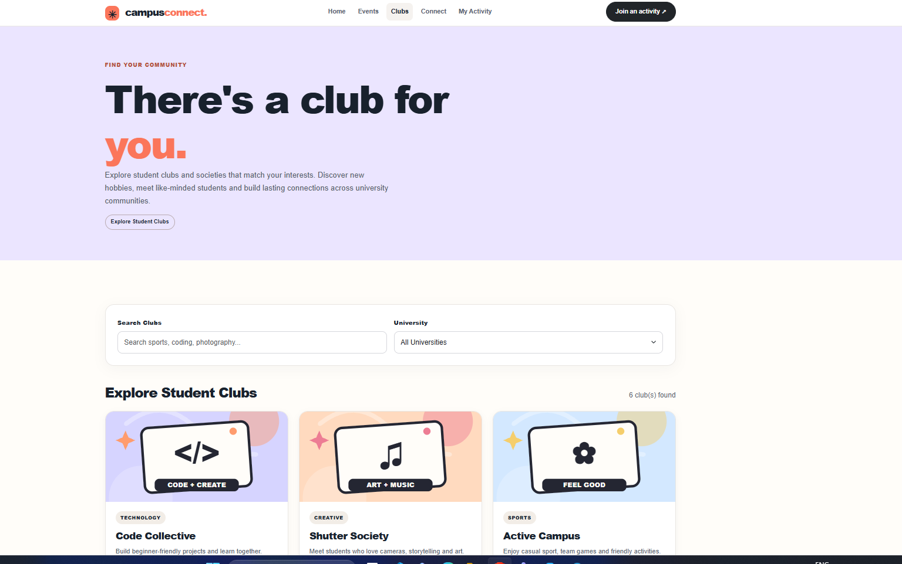
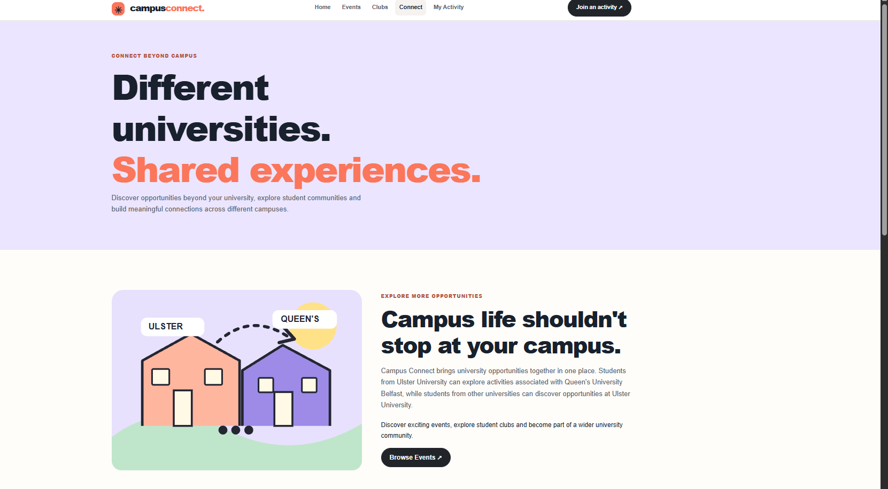
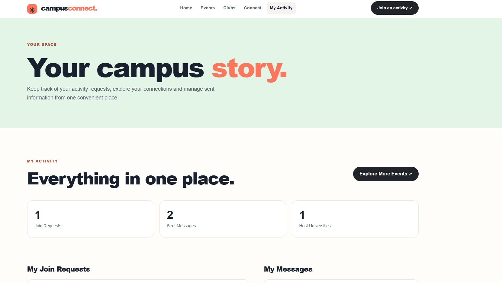

<div align="center">



# Campus Connect

### Find your people. Go beyond your campus.


</div>

---

## 🌐 Project Overview

Campus Connect is a responsive front-end website developed for JavaScript Coursework 2 (CW2). It helps students discover university events, explore clubs and societies, and connect with communities beyond their own campus.

The project includes fictional sample activities associated with Ulster University, Queen's University Belfast and Belfast Metropolitan College.

| Pages | Sample events | Sample clubs |
| :---: | :---: | :---: |
| 6 | 6 | 6 |

---

## ✨ Features

| Feature | Description |
| --- | --- |
| 🏠 Home | Introduction and navigation to events and clubs. |
| 📅 Events | Search and filter six sample events by university and category. |
| 🎨 Clubs | Search and filter six sample clubs by university. |
| 🤝 Connect | Cross-campus opportunities and a demonstration contact form. |
| 📝 Join an Activity | Validated join form with duplicate request prevention. |
| 📊 My Activity | View and delete saved requests and messages; see summary counts. |
| 📱 Responsive design | Custom CSS, Bootstrap and SVG illustrations. |

## 🛠️ Technologies Used

- HTML5 — page structure and forms.
- CSS3 — custom styling and responsive layouts.
- Bootstrap 5.3.3 (CSS via CDN) — layout and styling support.
- Vanilla JavaScript — DOM manipulation, event handling, filtering, validation and dynamic rendering.
- Web Storage API (`localStorage`) — browser-based data persistence.
- SVG — website illustrations and icons.

No backend or database is required.

## 🚀 Getting Started

1. Download or clone the repository and extract it if necessary.
2. Open the project folder in Visual Studio Code.
3. Open `index.html` using the Live Server extension (recommended), or run a local server with Python:

   ```bash
   python -m http.server 8000
   ```

4. If using Python, visit `http://localhost:8000` in your browser.
5. Use the navigation menu to explore the website.

An internet connection is recommended to load Bootstrap CSS from its CDN. No npm installation or build step is needed.

## 📁 Project Structure

```text
javascript_cw2_project-main/
├── index.html          # Home page
├── events.html         # Event listings and filters
├── clubs.html          # Club listings and filters
├── connect.html        # Cross-campus information and contact form
├── register.html       # Activity join request form
├── dashboard.html      # My Activity dashboard
├── css/
│   └── style.css       # Custom styles
├── js/
│   └── script.js       # Data and interactive functionality
├── images/             # SVG illustrations and favicon
├── screenshots/        # Website screenshots
│   ├── home.png
│   ├── events.png
│   ├── clubs.png
│   ├── connect.png
│   └── my-activity.png
└── README.md
```

## ⚙️ JavaScript Functionality

The main script stores sample events and clubs in arrays of objects. It dynamically creates activity cards, updates search results when filters change, and handles form submissions with client-side validation. The join form can preselect an activity using URL query parameters.

The following local storage keys are used:

| Key | Purpose |
| --- | --- |
| `campusConnectJoins` | Stores activity join requests |
| `campusConnectMessages` | Stores demonstration contact messages |

The dashboard reads these records, updates summary counts and allows individual records to be deleted.

## 📸 Website Screenshots

### Home — Find your people



| Events | Clubs |
| :---: | :---: |
|  |  |
| Discover and filter campus events | Explore student clubs and societies |

| Connect | My Activity |
| :---: | :---: |
|  |  |
| Explore cross-campus opportunities | Manage saved requests and messages |

<div align="center">

**Campus Connect · JavaScript Coursework 2**

*Different universities. Shared experiences.*

</div>
